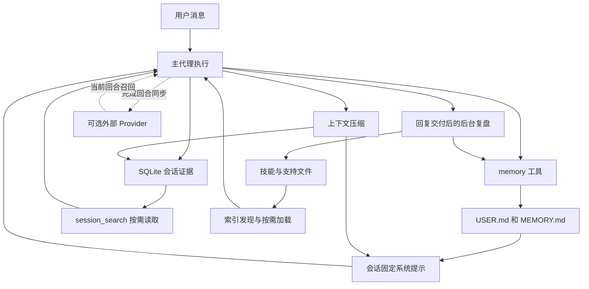

# Hermes Agent 记忆实现与 Dao 设计参考

Hermes 的默认记忆机制，是将少量跨任务事实、可检索的会话证据、按需加载的任务技能分开保存，再用主代理与后台复盘决定哪些经验值得沉淀。向量检索、用户建模和图谱能力可以由外部插件补充，并非默认核心实现。

对 Dao 最值得参考的是这些层之间的职责、缓存边界、写入保护和证据回溯。仅引入某个向量数据库，并不能复制 Hermes 的学习闭环。

## 分析版本与范围

- 上游：[NousResearch/hermes-agent](https://github.com/NousResearch/hermes-agent)。
- 本地：[Hermes 仓库](/Users/huaruoxu1/DaoProject/hermes-agent)。与 `dao-code` 同在 `/Users/huaruoxu1/DaoProject/`。
- 分支：`main`；提交：`1ae3c55e4bb16f495ebf0536a5672782d903e15e`，提交时间为北京时间 2026-10-27 11:21:53。
- 克隆方式：`--depth 1 --filter=blob:none`，当前提交的工作树已完整检出，历史为浅克隆。完整历史传输曾中断，因此改用 HTTP/1.1 完成下载。
- 本文分析默认本地记忆、会话搜索、后台复盘、技能维护、压缩边界，以及外部记忆插件的核心接入协议。独立仓库中 Honcho、Mem0 等服务的内部算法，不属于本次已核实的核心源码。
- Dao 对照的是 2026-10-27 当前工作区，包括尚未提交的 Mem0 适配；不是仅对照已发布版本。
- 验证方式为调用链阅读、配置核对和已有测试用例审阅。本次未运行 Hermes 测试或模型端到端评测；系统默认 Python 为 3.9.6，而仓库要求 `>=3.11,<3.15`，且新克隆尚未建立测试环境。

## 一 整体分层

| 层 | 保存什么 | 持久化位置或载体 | 何时进入模型上下文 |
| --- | --- | --- | --- |
| 精简长期事实 | 用户身份、稳定偏好、通用环境事实 | `$HERMES_HOME/memories/USER.md`、`MEMORY.md` | 会话初始化全量注入；正常压缩提交边界可刷新 |
| 会话证据 | 用户原话、助手回答、工具调用及结果 | profile 对应的 SQLite `state.db` | 主模型调用 `session_search` 后按需返回 |
| 程序性知识 | 某类任务的步骤、决策点、偏好和经验 | 技能目录中的 `SKILL.md` 与支持文件 | 技能索引供发现，正文按需加载；固定加载的技能另有路径 |
| 当前工作上下文 | 活跃消息、工具结果、压缩摘要与近期尾部 | 当前消息列表及会话持久层 | 每次请求使用；满窗后压缩 |
| 可选外部记忆 | 语义召回、用户表示、服务端提取等 | 由激活的 provider 决定 | 静态说明进系统提示；动态召回进当前消息的 API 副本 |

默认 `memory.provider` 为空，只启用核心本地机制。选择外部 provider 后，本地文件通常仍在：外部能力是附加层，而非必然替换本地存储。[配置](/Users/huaruoxu1/DaoProject/hermes-agent/hermes_cli/config_defaults.py:1310)、[初始化](/Users/huaruoxu1/DaoProject/hermes-agent/agent/agent_init.py:1210)。



这里的“学习”主要是修改下一次模型可读的外部状态，不是在线更新模型权重。

## 二 两个长期记忆文件的具体数据结构

`MemoryStore` 每个代理实例一份，持有 `memory_entries`、`user_entries` 两个字符串列表，以及独立的 `_system_prompt_snapshot`。条目之间使用完整分隔符 `\n§\n`，不是每行一条，因此单条可以包含多行。

| 目标 | 文件 | 默认预算 | 语义 |
| --- | --- | --- | --- |
| `memory` | `MEMORY.md` | 2,200 字符 | 代理需要跨任务记住的环境与约定 |
| `user` | `USER.md` | 1,375 字符 | 用户身份、偏好、沟通风格 |

预算通过 Python `len()` 计算，是字符数，不是字节数或 tokenizer 的 token 数；分隔符也占预算。两者合计默认 3,575 字符，提示块标题另计。配置中的 token 数只是估算，中文不能照搬英文字符/token 比例。

本地条目本质上是正文字符串，没有每条独立的数据库 ID、创建时间、置信度、来源引用、有效期、重要性分数或实体关系。时间和条件若要保留，必须写进正文。文件存放在 profile 对应的 `HERMES_HOME` 下，不会随 CWD 自动建立 Dao 式的项目／用户／知识三层命名空间。

启动时做顺序保持的精确去重。写入新条目时也只对完全相同的字符串去重；不是 embedding 相似度去重。语义重复、冲突、事实过期，主要靠模型判断并编辑。[存储实现](/Users/huaruoxu1/DaoProject/hermes-agent/tools/memory_tool_store.py:172)、[路径解析](/Users/huaruoxu1/DaoProject/hermes-agent/tools/memory_tool.py:42)。

## 三 什么时候决定记什么

### 主代理主动写入

主模型通过系统提示和工具描述理解“值得记住”的范围，自行调用 `memory`。用户说“记住”可以触发这个决策，但没有一个把每句用户话都自动持久化为事实的核心规则引擎。助手口头说“已记住”也不等于成功：必须有真实工具写入。

当前源码的内容路由相当严格：

- 跨所有任务仍适用的用户事实、稳定环境事实，进入两个小文件。
- 在某类任务中学到的步骤、坑、用户对该类结果的要求，优先进入技能。
- 临时任务状态、TODO、完成工作日志、很快会过期的事实，留在会话历史。
- 记忆写成陈述事实，例如“用户通常偏好简洁回答”，而不是“必须永远简洁回答”。这样减少旧偏好变成对当前用户要求的强制指令。

这是一套模型行为指导，不是底层可证明的事实质量验证。核心存储并不知道某条偏好是否仅在一次任务中成立。[指导提示](/Users/huaruoxu1/DaoProject/hermes-agent/agent/prompt_builder.py:195)、[工具描述](/Users/huaruoxu1/DaoProject/hermes-agent/tools/memory_tool.py:374)。

### 周期性后台复盘

默认 `memory.nudge_interval = 10`。`_tick_memory_nudge` 按用户回合累加；达到阈值后，在有最终回答、未被中断、允许后台复盘的条件下，交付回复后启动复盘。

技能复盘也默认间隔 10，但计数是代理迭代，不是用户回合：复杂任务一个回合内可能就达到技能复盘阈值。两者同时命中时使用联合复盘提示。只由技能阈值触发的复盘，当前实现不会因此自动获得 `memory` 写权限。

复盘 fork 读取对话快照，判断是否保存，不要求每次都产出记忆；没有值得保存的内容可以立即结束。它不是默认的“全量对话送入 Mem0 提取”，也不是对每条候选执行确认／晋升的结构化流水线。[计数](/Users/huaruoxu1/DaoProject/hermes-agent/agent/turn_context.py:761)、[回复后触发](/Users/huaruoxu1/DaoProject/hermes-agent/agent/turn_finalizer.py:831)、[复盘提示](/Users/huaruoxu1/DaoProject/hermes-agent/agent/background_review.py:367)。

### 会话边界和外部服务

外部 provider 可通过 `on_session_end` 在真正的会话边界提取信息，通过 `on_pre_compress` 在压缩前处理即将退出上下文的证据。`/new` 的外部记忆结束和切换操作以串行任务安排，避免旧会话迟到的提取写到新会话。

不要把这些外部 hook 理解成“默认本地两个文件在每次退出时必然完整蒸馏一次”。当前核心可直接确认的本地保存机制是工具写入和满足条件的后台复盘；外部提取语义取决于插件。[会话边界](/Users/huaruoxu1/DaoProject/hermes-agent/hermes_cli/cli_session_mixin.py:534)、[Provider 生命周期](/Users/huaruoxu1/DaoProject/hermes-agent/agent/memory_provider.py:181)。

## 四 写入协议与容量管理

模型可见的接口是一个目标加一组操作：

```json
{
  "target": "user",
  "operations": [
    {"action": "patch", "old_text": "偏好 Python", "content": "数据分析偏好 Python，前端偏好 TypeScript"},
    {"action": "add", "content": "用户主要使用中文沟通"}
  ]
}
```

支持 `add`、`patch`、`remove`。一次调用只修改一个目标文件；涉及两个文件时需要分别调用，因此不存在跨两个目标的统一事务。

`old_text` 定位条目时，完整条目精确匹配优先，其次是子串匹配；存在不同条目的歧义则拒绝。定位还提供引号、破折号、空白归一化的容错。但 `patch` 实际替换的是唯一的原文片段，不是语义改写，也不是任意模糊编辑；片段重复或改后不变都会失败。

以前的 `replace` 是“用子串找到一条，再整条替换”，模型容易误认为只是替换子串，从而丢掉条目中的其他事实。当前公开工具已经拒绝 `replace`，指向 `patch`；内部方法与旧待审批记录重放仍保留兼容。[动作入口](/Users/huaruoxu1/DaoProject/hermes-agent/tools/memory_tool.py:264)、[片段修改](/Users/huaruoxu1/DaoProject/hermes-agent/tools/memory_tool_store.py:142)。

容量满时的流程是：

1. `add` 超限，返回当前条目、使用量和至少需要释放的字符数。
2. 模型选择删除陈旧条目或缩短已有条目，并把新事实放进同一个 `operations` 批次。
3. 在内存副本上顺序执行，最后检查总字符数；中间暂时超额可以，最终结果必须合法。
4. 任意操作失败，整批不写；合法后一次持久化。

因此这是**硬容量约束加模型维护**，不是自动 LRU、TTL、重要性排序或遗忘曲线。核心没有自动将满出的条目迁移到冷存储。模型整理选错，就可能损失有效事实；小容量本身也会迫使它舍弃细节。

另有防循环保护：每回合累计整理失败，前三次允许修正，超过阈值返回 `done: true`，要求停止重试并继续回答用户。成功操作或新回合会重置计数。成功响应不回显全库，而是给使用量、条目数和“本次已完成”；修改／删除则可附具体旧正文。这减少模型看到整库后继续无休止整理。[预算和失败处理](/Users/huaruoxu1/DaoProject/hermes-agent/tools/memory_tool_store.py:197)、[批处理](/Users/huaruoxu1/DaoProject/hermes-agent/tools/memory_tool_store.py:568)。

## 五 写入可靠性与保护边界

`MemoryStore._mutate` 的路径是：文件锁 → 重新读磁盘 → 解析并修改 → 校验 → 临时文件原子替换。锁落在独立的 `.lock` 文件，Unix 使用 `flock`，Windows 使用 `msvcrt`，避免两个正常写入者从各自旧快照覆盖对方刚保存的内容。

这改善的是文件层并发可靠性，不代表多个独立代理共用一个 profile 就有正确的知识归属；官方仍建议不同代理使用不同 profile。

具体保护包括：

- 已存在但无法读取／UTF-8 损坏的文件，拒绝写入，不能按“空库”重建。
- 手工追加导致单条异常超长时，拒绝危险重写，并保存漂移备份；删除异常条目前也尝试保留快照。
- 普通合并批次不能意外把原本非空的库清空；明确单条删除另有通道。
- 写入时扫描注入、外传等威胁模式；加载时再扫描，命中条目在系统提示快照中变为 `[BLOCKED: ...]`，原始磁盘文本保留供处理。
- `memory.write_approval` 默认关闭，启用后支持前台确认或暂存待审批。
- **无人值守后台复盘中的 `patch`／`remove` 即使普通审批开关关闭，也不能直接执行**：改为待审批提议；`add` 仍可执行。
- 待审批的修改／删除绑定当时完整条目，审批时如果条目已变更，拒绝把旧批准套到新内容上。

模式扫描不能证明事实正确，也不能识别所有敏感信息；不能把它等同于来源验证或冲突消解。普通小文件也没有完整的逐条版本数据库。[锁与读取](/Users/huaruoxu1/DaoProject/hermes-agent/tools/memory_tool_store.py:252)、[原子修改](/Users/huaruoxu1/DaoProject/hermes-agent/tools/memory_tool_store.py:349)、[后台限制](/Users/huaruoxu1/DaoProject/hermes-agent/tools/memory_tool.py:189)。

## 六 如何读取与保持缓存稳定

本地文件没有模型可见的 `read`／`search` 动作，因为全部精简条目已在系统提示中。

初始化 `load_from_disk()` 同时建立两种视图：

- 实时条目列表：服务于后续工具修改。
- 冻结提示快照：`format_for_system_prompt()` 只返回这个版本。

中途写盘不会改掉已经发送的系统提示；模型可以从本轮工具结果和对话知道新事实，但下一次请求的旧前缀保持不变。新会话重新加载。

**当前版本还有一个明确的刷新点：正常压缩提交边界。** `_rebuild_system_prompt_at_boundary()` 调用 `_invalidate_system_prompt()`，后者重新加载文件并重建提示。压缩已经改变上下文，这是被允许的缓存断点。部分持有预置提示的独立 gateway 压缩代理会保留原提示，不能把“所有压缩路径都刷新”写成绝对规则。[提示拼装](/Users/huaruoxu1/DaoProject/hermes-agent/agent/system_prompt.py:522)、[失效刷新](/Users/huaruoxu1/DaoProject/hermes-agent/agent/system_prompt.py:816)、[压缩提交边界](/Users/huaruoxu1/DaoProject/hermes-agent/agent/conversation_compression.py:3082)。

后台复盘的缓存处理更值得 Dao 参考：同模型 fork 继承父代理的系统提示字节、会话起始时间、工具 schema 和缓存作用域。工具调用权限在执行端用白名单限制，不通过缩减模型看到的工具表破坏前缀。

fork 的会话持久化被禁用、数据库句柄清空，不让“请审查记忆”这类内部指令混入真实用户历史；它共享记忆存储，但不修改父对话快照。切到另一个辅助模型时缓存本来就无法复用，所以改用旧历史摘要加近期原文。

复盘默认最多 16 次迭代，另有累计输入 token 上限；前台新消息可取消复盘，等待确认有约 2 秒的上界。缓存命中依赖服务商和路由，不能仅凭继承对象就宣称实测命中率或“免费”。[fork 实现](/Users/huaruoxu1/DaoProject/hermes-agent/agent/background_review.py:969)、[执行白名单](/Users/huaruoxu1/DaoProject/hermes-agent/agent/background_review.py:1092)、[成本预算](/Users/huaruoxu1/DaoProject/hermes-agent/agent/background_review.py:173)。

## 七 历史会话如何检索

`state.db` 保存会话和消息；消息可以包含角色、正文、工具调用、工具结果、推理字段和 API 内容副本等。SQLite 使用 WAL 支持读写并行。`session_search` 是核心的长期证据回溯工具，**当前版本不调用 LLM，也不调用 embedding**。

四种使用形态共用一个工具：

| 参数形态 | 行为 |
| --- | --- |
| `query` | 全文发现相关会话 |
| `session_id` | 阅读会话，长会话返回首尾 |
| `session_id` 加 `around_message_id` | 读取命中消息周边窗口 |
| 无查询、无会话 ID | 浏览近期会话 |

搜索路径包含 FTS5、标题命中、时间范围过滤，以及中文等 CJK 文本的专门支持。默认发现只搜索用户／助手角色；底层支持其他角色过滤。常规全文按相关度排序，可请求时间排序。CJK 有可用时的 bigram tokenizer、trigram 和 LIKE 回退，因此不是仅适用于空格分词语言的简单全文查询。

发现阶段最多扫描 300 个候选消息，再按会话 lineage 去重并组织返回；默认返回 3 个会话。交互会话排在 cron 记录之前，避免高频自动任务占满结果；子代理、工具集成、kanban worker 等来源被隐藏。最高结果详细展开，其他结果较紧凑，后续再围绕消息 ID 读取。长会话默认首 20 条加尾 10 条，read 形态单条正文上限 2,000 字符。

关键判断不是“是不是当前 session ID”，而是**证据还在不在活跃上下文里**：当前活跃消息通常不重复召回；已经压缩归档、移出上下文的同一会话消息则允许召回。旧版压缩父链和 `/new` 前驱也专门处理。

这使它能够回答“上次为什么这样决定”，而不是只返回一句已经失去理由的用户偏好。局限也很直接：词面召回并不等于语义召回；改写、隐含关系、跨语言同义表达可能漏召回。搜索返回原文也不代表原文仍然正确。

[工具与检索策略](/Users/huaruoxu1/DaoProject/hermes-agent/tools/session_search_tool.py:354)、[读取窗口](/Users/huaruoxu1/DaoProject/hermes-agent/tools/session_search_tool.py:447)、[底层搜索](/Users/huaruoxu1/DaoProject/hermes-agent/hermes_state_search.py:1292)、[CJK 索引](/Users/huaruoxu1/DaoProject/hermes-agent/hermes_state_fts.py:21)、[消息模型](/Users/huaruoxu1/DaoProject/hermes-agent/hermes_state_common.py:531)。

## 八 上下文压缩如何与记忆衔接

压缩处理“当前请求放不下”，精简长期记忆处理“下次应记住什么”；两者独立。

默认 `compression.enabled = true`、`in_place = true`。源码配置的基础阈值为 0.50，但小于 512K 的上下文窗口有提高到至少 0.75 的规则，另有模型覆盖和绝对 token 上限选项，不能简单说“全部模型到 50% 就压缩”。

核心算法会裁剪旧工具输出、保留近期尾部、生成结构化摘要；还有原始用户消息、锚点和检索指针等防丢上下文机制。默认原地压缩保留会话 ID，将旧消息软归档为 `active=0, compacted=1`。它们不再用于活跃上下文，却仍可被历史搜索找到。

启用外部 provider 时，压缩前可调用 `on_pre_compress`，返回洞见参与摘要。默认是尽力而为；`compression.checkpoint_required=true` 则要求兼容 v2 checkpoint 的 provider 成功完成交接，否则拒绝继续有损压缩。它是可选的可靠性契约，不是默认本地双文件的保证，也不应把 provider 的“成功声明”扩大为对其后端实现的独立验证。

[压缩配置](/Users/huaruoxu1/DaoProject/hermes-agent/hermes_cli/config_defaults.py:576)、[压缩前交接](/Users/huaruoxu1/DaoProject/hermes-agent/agent/conversation_compression.py:2889)、[可检索归档测试](/Users/huaruoxu1/DaoProject/hermes-agent/tests/tools/test_session_search.py:701)。

## 九 技能是它的大容量经验层

Hermes 把“如何做某类事”保存为技能：正文是可执行的流程，`references/`、`scripts/`、`templates/` 等放条件性细节。后台复盘要求优先改进现有技能，避免每次会话生成一篇事故纪要，也避免把一次安装失败沉淀成“这个工具永远不能用”。

读取采用索引发现、按需正文加载。系统提示中的技能目录也受缓存稳定约束；当前实现新增／移除技能的目录差异通过当前回合消息注记通知，不就地重写旧系统提示。[经验格式](/Users/huaruoxu1/DaoProject/hermes-agent/agent/background_review.py:391)、[目录增量](/Users/huaruoxu1/DaoProject/hermes-agent/agent/skills_index_delta.py:1)。

Curator 是技能维护器，不是 `MEMORY.md` 的遗忘算法。默认：

- 开启；两次维护至少间隔 168 小时，要求至少空闲 2 小时。
- 首次观察先建立时间基线，不立即清理。
- 通常只管理 agent 创建的技能；内置技能清理需单独选择。
- 14 天未使用标 stale，30 天未使用归档；归档可恢复，默认不自动永久删除。
- pinned 和 cron 引用的技能跳过自动迁移。
- 大模型合并默认关闭；打开后才进行技能合并／重构，并有备份与审计记录。

需要区分 pin 的不同消费者：Curator 跳过 pinned；当前普通 `skill_manage` 的 pin 保护重点是删除，并不是所有修改都禁止。后台来源还有额外限制。不能直接照旧文档将 pin 理解成全局只读。

[维护器](/Users/huaruoxu1/DaoProject/hermes-agent/agent/curator.py:209)、[默认值](/Users/huaruoxu1/DaoProject/hermes-agent/hermes_cli/config_defaults.py:1497)、[技能保护](/Users/huaruoxu1/DaoProject/hermes-agent/tools/skill_manager_guards.py:143)、[使用统计](/Users/huaruoxu1/DaoProject/hermes-agent/tools/skill_usage.py:522)。

## 十 外部记忆 Provider 的完整接入路径

核心一次最多激活一个外部 provider。`MemoryProvider` 提供协议，`MemoryManager` 负责调用时序、异常隔离、线程上下文、工具分发和部分数据处理。默认本地文件并不依赖这个 manager 才能工作。

| 时机 | 接口 | 核心语义 |
| --- | --- | --- |
| 初始化 | `initialize` | 传入 profile home、会话、平台、工作区和用户身份等 |
| 建系统提示 | `system_prompt_block` | 静态说明，不应承担每轮动态召回 |
| 每回合开始 | `on_turn_start`、`prefetch` | 用当前真实用户查询取相关背景 |
| 回答交付后 | `sync_turn` | 同步完成回合，可带完整消息及当轮作者 |
| 完成回合后 | `queue_prefetch` | 为后续回合安排预取 |
| 本地写入成功后 | `on_memory_write` | 镜像确已提交的 add／replace／remove |
| 压缩前 | `on_pre_compress` | 提取洞见或执行严格 checkpoint |
| 真正结束／切换 | `on_session_end`、`on_session_switch` | 提取、刷新或重新绑定会话 |
| 子任务完成 | `on_delegation` | 父侧观察子任务结果 |
| 释放 | `shutdown` | 在有界等待内清理队列与连接 |

### 召回注入

每个用户回合最多执行一次核心 prefetch，工具循环复用结果。空消息、斜杠命令及匹配 trivial 提示规则的寒暄／确认会跳过；该规则不是通用多语言语义分类器。

外部 `prefetch` 在独立线程运行，但核心会有界等待，默认 8 秒；超时返回空，卡住的调用由限流／探测机制处理。因此它不是“严格零等待的非阻塞召回”。`sync_turn` 则放在串行后台 worker，保证提交顺序并减少主回复延迟。[召回与同步](/Users/huaruoxu1/DaoProject/hermes-agent/agent/memory_manager.py:346)。

召回文本包装为 `<memory-context>`，追加到**当前用户消息的模型 API 副本**。原始用户正文独立保存，实际发送的注入内容通过 `api_content` sidecar 持久化，后续请求复用这段字节，既保持缓存，又避免把召回文本误记成用户亲口说的话。还有重复 bullet 去除和输出清理器，减少内部记忆块直接泄漏到回复。

一个设计张力是：wrapper 明确说这不是新用户输入，但又称为 authoritative reference data。这会强化模型信任。对错误／过期／推断型记忆，核心没有在该 wrapper 中统一附加结构化置信度，Dao 不宜直接复制这份强信任语气。[注入实现](/Users/huaruoxu1/DaoProject/hermes-agent/agent/turn_context.py:912)、[包装文本](/Users/huaruoxu1/DaoProject/hermes-agent/agent/memory_context.py:169)。

### 同步和隔离

被中断的回合不进行正常完成回合同步，避免把半成品当成完成事实。发给外部 provider 的查询、消息、工具输出、镜像内容等统一做可识别密钥脱敏；本地原始会话仍可能保留原文。无法识别形态的任意密码不在这个保证内。

只有本地工具真正成功提交，且未被暂存为审批提议，才镜像。局部 `patch` 在通知外部服务时转换为完整新条目的 `replace`，并带上锁内确定的旧正文和来源元数据。这个镜像是 hook，不是本地文件和远端服务之间的分布式事务；远端异常可能造成不一致。

后台线程复制 ContextVars；manager 绑定创建时的 profile，拒绝跨 profile 误用。当前回合作者也能单独传递，避免群聊所有信息都归给最初打开会话的人。进程退出的排队同步只做有界排空，默认约 5 秒，不能据此承诺所有尚未完成的外部写入永不丢失。[同步入口](/Users/huaruoxu1/DaoProject/hermes-agent/run_agent.py:888)、[镜像门](/Users/huaruoxu1/DaoProject/hermes-agent/agent/memory_manager.py:768)、[身份隔离](/Users/huaruoxu1/DaoProject/hermes-agent/agent/memory_caller_scope.py:1)。

### 与 Mem0 和 Honcho 的关系

当前核心仓库里的 catalog 将 Mem0、Honcho 等指向独立仓库及固定 SHA。Mem0 catalog 描述包括服务端事实提取、语义检索、自动去重，以及不同运行模式；Honcho 面向持续用户／peer 建模。这些属于可选插件提供的能力，不能算作默认本地 `MemoryStore` 已实现。

本次没有安装或启用任何外部记忆服务，也没有把本机对话发送给它们。[Mem0 catalog](/Users/huaruoxu1/DaoProject/hermes-agent/plugin-catalog/mem0.yaml:1)、[Honcho catalog](/Users/huaruoxu1/DaoProject/hermes-agent/plugin-catalog/honcho.yaml:1)。

## 十一 用一个连续例子理解整个闭环

假设用户在任务中说：“我一般用中文沟通；这个项目的数据脚本用 Python，但不要把临时试验失败当成以后禁用工具的理由。”

1. 跨任务语言偏好可以写 `USER.md`；是否值得存由模型判断并真实调用工具。
2. 项目脚本规则、处理试验失败的方法，更适合带适用场景的技能；当轮操作原话始终留在会话证据里。
3. 后台复盘可能补上漏掉的持久信息；无需为了完成复盘硬造一条记忆。
4. 下次新会话，用户语言偏好已在固定前缀；具体任务技能需要被发现／加载。
5. 用户追问“上次为什么没用那个工具”，代理调用 `session_search`，找到原始尝试和结果，而不是把一句结论当成全部事实。
6. 若用户纠正偏好，前台可以 `patch` 适用片段；如果只是后台复盘想删改旧记忆，则先形成提议。
7. 长会话压缩后，旧原文仍在 SQLite 可查；正常压缩边界可以刷新长期记忆快照。

这一闭环同时需要“少量默认知道”“相关时会查”“能找回理由”“可以纠错”。缺少任何一环，记忆条数再多也可能只表现为机械重复。

## 十二 对 Dao 的参考价值

Dao 当前的 [MemoryBackend](/Users/huaruoxu1/DaoProject/dao-code/src/memory/backend.ts:10) 与 Hermes 的 `MemoryProvider` 不在同一抽象层：前者统一 list/search/put/replace/remove；后者主要统一代理生命周期与外部记忆交互。

| 维度 | Hermes 当前核心 | Dao 当前工作区 | 对 Dao 的启示 |
| --- | --- | --- | --- |
| 启动注入 | 两个小文件全文冻结 | 高价值全文加长尾标题索引 | 保持已有分层，增加真实 token 预算，别退回只有两个小文件 |
| 长期数据模型 | 正文字符串，结构元数据少 | 类型、作用域、来源、置信度等 | 保留结构化语义，避免压成一句无来源的偏好 |
| 语义检索 | 默认核心没有；外部 provider 可提供 | Mem0 模式提供向量召回 | 存储能力已有基础，重点评测召回是否改善决策 |
| 历史证据 | SQLite 搜索加消息锚点，压缩原文可回查 | 有会话持久化；当前 `src` 未见对应 `session_search` 工具 | 补证据检索，连接偏好／判断与原始依据 |
| 学习产物 | 跨任务事实与任务技能分流 | 记忆工具支持 user、feedback、procedural、semantic、episodic 等 | 明确每类内容进入常驻记忆、检索层或技能的标准 |
| 外部存储接入 | 本地继续存在，加外部同步／召回 | files 或 mem0 后端选择，不双写 | 不为模仿 Hermes 引入双写真源；生命周期可另行抽象 |
| 纠错保护 | patch、原子批次、旧条目钉住、后台删改提议 | 后端 replace 及元数据约束 | 增加版本条件和变更预览，区分新增与破坏性整理 |
| 并发 | 文件锁加锁内重读，外部串行 worker | Mem0 适配器单实例串行 | 后续多进程共享需要超出单实例的并发契约 |
| 自动遗忘 | 小文件无评分衰减；技能有 Curator | 文件模式有 GC；Mem0 模式不运行旧文件 GC | 将遗忘策略绑定真实后端能力，不能只宣称统一已有 |

Dao 的 Mem0 写入使用 `infer:false`，因为 Dao 已负责提取与保留条件／来源；这与把原始整轮对话交给外部服务再提取是不同路线。应先确定提取责任归属，避免双重提取丢失用户为什么作某个选择。[Dao Mem0 适配](/Users/huaruoxu1/DaoProject/dao-code/src/memory/mem0.ts:8)、[注入逻辑](/Users/huaruoxu1/DaoProject/dao-code/src/memory/inject.ts:62)、[接入边界](/Users/huaruoxu1/DaoProject/dao-code/docs/architecture/mem0-personal-agent.md)。

结合 Dao “理解用户判断”的方向，建议优先顺序如下：

1. **证据可追溯**：记忆指向 session／message，能查原话、当时条件、选择理由。首先补回忆依据，再考虑更复杂图谱。
2. **写入可纠正**：保留明确表达与推断的区别；新增、修正、否定、删除采用不同策略；后台不能无依据扩大或删除用户偏好。
3. **条件性召回**：全局偏好常驻，任务经验按场景召回；避免“用户这次选了 Python”变成“用户任何项目都只要 Python”。
4. **统一生命周期**：在存储后端之上安排 turn end、压缩前、真实 session end、身份切换、关闭排空等时机，不让业务层散落调用 SDK。
5. **缓存与预算实测**：保留固定前缀；额外召回只追加当前消息；fork 的 prompt、tools、cache scope 一起验证；控制单轮、单会话和后台累计成本。
6. **技能与记忆分工**：事实陈述进入记忆，工作流程进入技能，历史理由留在证据层。将 Curator 式治理用于技能，别直接拿“不常用”淘汰重要用户事实。

这些是参考后的设计建议，本次未改动 Dao 的记忆业务代码。

## 十三 已有测试体现的行为契约

本次阅读了以下实现与测试断言，未把“存在测试”写成“本机已测试通过”：

| 测试入口 | 能说明的契约 |
| --- | --- |
| [本地记忆测试](/Users/huaruoxu1/DaoProject/hermes-agent/tests/tools/test_memory_tool.py) | 超限拒绝、去重、批次原子性、读取异常不清空、加载时威胁隔离、后台删改暂存 |
| [工具 schema 测试](/Users/huaruoxu1/DaoProject/hermes-agent/tests/tools/test_memory_tool_schema.py) | 模型可见动作和目标限制 |
| [缓存继承测试](/Users/huaruoxu1/DaoProject/hermes-agent/tests/agent/test_background_review_cache_parity.py) | 同模型 fork 的 prompt、tool、session 与缓存作用域继承 |
| [历史搜索测试](/Users/huaruoxu1/DaoProject/hermes-agent/tests/tools/test_session_search.py) | 返回窗口、cron 降权、profile 隔离、压缩归档仍可召回 |
| [召回去重测试](/Users/huaruoxu1/DaoProject/hermes-agent/tests/agent/test_memory_context_dedupe.py) | 删除重复独立 bullet，同时保留带续行的来源／条件 |
| [压缩前交接测试](/Users/huaruoxu1/DaoProject/hermes-agent/tests/agent/test_pre_compress_memory_context_handoff.py) | 规范化证据的交接路径 |

这些工程契约还不能回答“长期记忆是否让代理更懂用户”。Dao 后续评测应覆盖：一次偏好不得泛化、用户纠正覆盖旧推断、同主题不同项目隔离、压缩后理由可回溯、后台提炼失败不阻塞主任务、外部服务不可用时的明确降级，以及有无记忆的实际任务效果与成本差异。

## 十四 读上游时容易误判的地方

| 常见理解 | 当前源码边界 |
| --- | --- |
| Hermes 默认就是向量记忆库 | 默认是小文件加 SQLite 词面检索；外部 provider 可扩展语义能力 |
| session_search 会调用模型概括旧会话 | 当前返回真实数据库消息，不再调用辅助 LLM |
| MEMORY.md 写满会自动压缩或按重要性遗忘 | 工具拒绝，模型决定如何整理；不是存储层自动淘汰 |
| 会话中记忆永远不会重新加载 | 普通写入不刷新；正常上下文压缩提交边界会刷新 |
| 接入外部记忆就替换了两个本地文件 | 外部默认附加，本地仍可继续工作 |
| 后台复盘可以直接整理所有旧记忆 | 当前无人值守 patch／remove 需要暂存审批 |
| Curator 会让长期事实自动遗忘 | 它主要维护技能，不是两个事实文件 |
| 一份 README 就能说明最新版所有行为 | 文档仍有旧例子：完成任务日志路由、冻结例外、pin 的含义均需对照代码 |

Hermes 最有价值的部分，是围绕普通存储做出了明确的学习时机、缓存边界、写入反馈与历史证据链；它并没有仅靠默认两个记忆文件就实现完整的个人判断模型、自动真伪校验或无限规模语义知识库。
