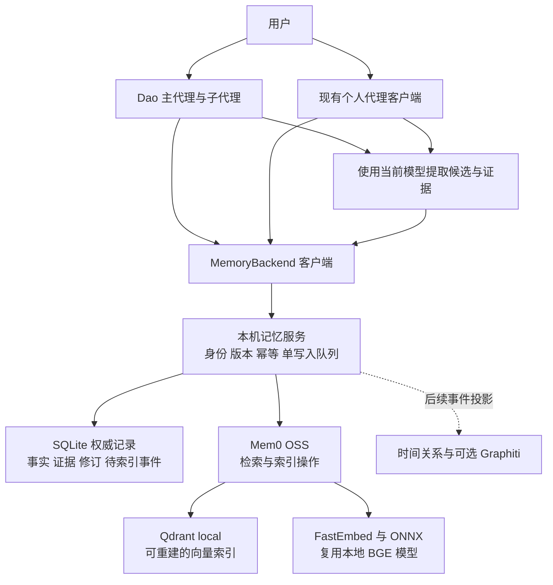

# Dao 个人代理与本地记忆技术方案

状态：待评审。日期：2026 年 10 月 26 日。

本方案建议以 Dao 为个人代理的主要交互与执行入口，复用个人代理项目中已下载的 BGE 模型及 Python Mem0 运行经验，建设一个按需启动、同一用户共享的本机记忆服务。记忆提取继续使用代理当前的模型，embedding 在本机完成。先交付可靠的跨会话记忆，再增加决策案例、判断原则和目标管理；时间知识图谱保留为有明确需求后的扩展。

这是目标设计，不代表已经实现。现有 `feat/mem0-personal-agent` 分支是第一轮 Node Mem0 集成原型；本方案会调整其后端实现，但保留已经建立的工具与后端边界。此次只新增方案文档，不启用服务、不迁移实际记忆、不更改现有模型配置。

## 1 目标与交付边界

个人代理应当记住用户真正表达过的偏好，理解具体决策的理由，并在适用的新情境中使用这些信息。它必须能解释“依据哪条交互得出这个判断”，允许用户纠正和忘记，也不能把过去的愿望当成今天的行动授权。

首个可用版本必须做到：

- Dao 重启、切项目后，仍能召回有权限使用的用户记忆。
- 多个 Dao 会话共用一个模型实例和一套记忆，不相互覆盖更新。
- 同名项目、不同用户、工作副本与子代理的身份处理明确。
- 中文语义召回不依赖 OpenAI embedding API，也不依赖 Ollama。
- 记忆失败不阻断主任务；失败、空结果和已保存必须可区分。
- 提取、保存、检索、使用、纠正都可追踪；重复执行不重复保存。

首期不包含跨机器同步、多人共享服务、自动模型训练、Graphiti 部署，也不重写 Dao 的执行、审批和任务调度系统。现有自动记忆开关保持显式，不因更换后端扩大后台行为。

## 2 实际基础与需要修正的假设

| 项目 | 已有能力 | 尚未解决 |
| --- | --- | --- |
| Dao 主体 | 工具、会话、子代理、审批、反思器、文件记忆 | 文件检索偏关键词；个人判断结构不足 |
| Dao 当前分支 | Node `mem0ai/oss` 3.3.1、本地 SQLite、统一 `MemoryBackend`、工具与纠错接线、导入入口 | 配置只接 OpenAI 兼容 embedding；未接本地 ONNX；实例内串行不能保证多个 CLI 的读改写一致性 |
| `autoagent` 项目 | Python Mem0 2.2.1、FastEmbed 0.9.1、ONNX Runtime、Qdrant local、记忆工作进程、提取证据检查 | 每个 CLI 单独加载模型；整个数据目录使用排他锁，不支持同目录多 CLI 同时交互；与 Dao 没有统一身份和记忆协议 |
| 本地模型 | `BAAI/bge-small-zh-v1.5`，512 维，ONNX 文件 94,781,076 字节 | 尚未针对 Dao 的真实记忆做检索质量评测 |

现有模型路径：

```text
/Users/huaruoxu1/CodexProject/autoagent/.autoagent/models/BAAI--bge-small-zh-v1.5/
```

已有记录报告冷启动加写入约 0.97 秒、热查询中位约 2 毫秒、工作进程峰值 RSS 335.3 MB；样本仅 5 次，且是单条短中文记忆。这些数值用于估计起点，不能作为多会话或大记忆库的性能承诺。[本地记录](/Users/huaruoxu1/CodexProject/autoagent/artifacts/embedding-benchmark.json)

当前 `LocalEmbedding` 按操作调用 `query_embed` 或 `passage_embed`。进一步核对安装版本后发现，BGE 使用的通用实现最终都调用 `embed`，不能据接口名字断言已经自动添加 BGE 查询指令。首期固定复用现有无额外前缀策略；是否加入查询指令由同一评测集决定，并纳入向量空间版本。

## 3 架构选择

| 方案 | 优点 | 主要代价 | 结论 |
| --- | --- | --- | --- |
| OpenAI embedding API | 接入直接，无本地推理维护 | 单独计费，文本发送远端，未复用已下载模型 | 保留可选能力，不作为本方案默认 |
| Node Mem0 加本地 embedding HTTP 服务 | 保留当前 Dao 原型较多 | Node 与 Python 仍维护两套记忆；统一纠错、身份和多进程写入还要再做一层 | 若只优化 Dao 单应用可选，本次不优先 |
| Node 原生加载 ONNX | 最终可减少 Python 依赖 | 需重新实现并验证 tokenizer、池化、归一化、模型分发及 Bun 原生依赖 | 暂缓，不能靠同名模型假设数值一致 |
| 本机 Python 记忆服务 | 复用已有运行链路，一处加载模型，一处协调写入，两个客户端共用协议 | 需交付服务生命周期、协议和 Python 环境管理 | 推荐 |

推荐的服务是本地进程，不是部署一套云平台。初期使用 Unix domain socket，不增加公网端口，也不引入 Redis、Docker 或 Neo4j。macOS 为首发验证平台；Linux 复用协议验证后支持。Windows 的本地传输适配单独安排，不影响文件兼容模式。



Dao 的代理运行仍在 Node/Bun 内。Python 服务不执行用户任务，不调用 Coding Agent，不负责决定用户授权；它只处理记忆协议请求。两个客户端只有迁移到统一服务后才共享记忆，不能把“共用模型文件”当成“已经共享记忆”。

## 4 数据权威与 Mem0 的职责

采用 **SQLite 记忆记录为权威，Mem0 向量数据为可重建索引**。这与当前 Dao 原型直接以 Mem0 内容为主存储不同，是本方案明确新增的设计。

原因不是另造一个向量库，而是个人代理需要跨进程版本检查、证据关联、幂等、批次提交和失效传播。这些语义必须由我们控制，不能假设 Mem0 的一组 API 调用具备跨数据库事务。所有客户端只访问服务，不双写两处。

| 组件 | 负责 | 不负责 |
| --- | --- | --- |
| 代理提取器 | 从交互提出事实、修正、决策及对应证据 | 直接修改数据库、改变作用域权限 |
| 记忆服务 | 校验证据、身份、版本、状态；提交修订；协调索引 | 代替用户授权或推断未表达的承诺 |
| SQLite | 记录当前正文、历史修订、来源、待处理事件 | 生成语义向量 |
| Mem0 OSS | 调用 embedding、保存检索条目、执行向量查询 | 独立决定个人判断原则、承担全部事务保证 |
| BGE 模型 | 将正文与查询转换为向量 | 判断事实真伪、更新目标或执行任务 |

初期保持 `infer=False`。提取只发生在代理侧，防止第二次提取丢掉理由、条件或重复计费。官方文档明确说明该模式跳过提取、保存输入；因此去重与更新必须由服务显式负责，不能指望 Mem0 自动消除重复。[Mem0 写入说明](https://github.com/mem0ai/mem0/blob/main/docs/core-concepts/memory-operations/add.mdx)

## 5 本地模型与向量空间

使用已有的 BGE 中文小模型，不重新下载大模型。模型与 tokenizer 等资源应视为同一个版本化单元。现有下载脚本固定了 ONNX 来源修订与主文件 SHA256，但其它资源还需要补充哈希清单。

初始化阶段只读验证已有模型，生成模型清单；正式安装可选择直接引用已验证目录，或复制到用户级模型目录。默认先复用文件，不移动、不删除 `autoagent` 的原模型。运行期间不自动联网下载；缺失、损坏时明确报告 `MODEL_MISSING` 或 `MODEL_INVALID`，不自动退回远程 embedding。

拟采用的指纹包括：模型名称、来源修订、全部资源哈希、tokenizer 配置、512 维、池化方式、归一化、query/passage 前缀、文本预处理和分块算法版本。指纹不同的向量进入不同 generation，不能直接混合比较。

模型输入限制按 tokenizer 实际 token 数计算，不按中文字符数估算。BGE 模型卡提供了模型及检索指令说明；FastEmbed 官方也建议区分查询与正文入口，但具体行为仍需以固定版本测试确认。[BGE 模型卡](https://huggingface.co/BAAI/bge-small-zh-v1.5) · [FastEmbed 文档](https://qdrant.tech/documentation/tutorials-basics/generate-embeddings-fastembed/)

拟定处理规则：

- 每条原子事实尽量在 400 个模型 token 内，包含必要的条件和理由。
- 不能为了适配模型把长原文直接截断后冒充完整事实。权威库保留全文；索引按句子边界分块，每块预留特殊 token 与前缀空间，初始重叠 40 token。
- 每块带 `memory_id/revision/chunk_id`，召回后合并到原记忆，再回读权威正文。
- 查询过长返回可识别的长度错误，调用者缩短检索问题；首期不隐藏调用额外 LLM 压缩查询。
- 固定空白和换行规范；不要擅自抹掉版本号、路径大小写或否定词。
- 数值验收包含维度、有限数值、范数、固定输入的一致性，以及 query/passage 两种路径。

## 6 服务进程与安装布局

建议的用户级布局如下，名称是拟定接口，不是已安装目录：

```text
~/.dao/memory-service/
  config.json                 服务配置，不放模型 API 凭据
  runtime/                    独立且锁定依赖的 Python 环境
  model-manifest.json         已验证模型路径及完整指纹
  memory.db                   权威正文、修订、操作与 outbox
  indexes/<generation>/       Mem0 与 Qdrant local 索引
  run/service.lock            操作系统文件锁
  run/service.sock            本机协议入口
  logs/                       默认仅结构化元数据
  backups/                    用户触发的一致性备份
```

PoC 可用现有 Python 环境验证接口，正式版本不能硬编码依赖 `/Users/huaruoxu1/.../.venv`。安装步骤负责建立独立运行环境，固定已验证依赖；Dao 二进制保留“未安装服务时使用原文件模式”的能力。启用服务后不在失败时偷偷切回文件模式。

进程生命周期：

1. Dao 需要记忆时先连接 socket 并做协议握手。无服务则尝试启动。
2. 服务通过 OS 排他文件锁选出唯一实例；锁由进程存活持有，退出自动释放。仅 PID 文件不够。
3. 胜出的实例打开权威库、初始化唯一 Qdrant local 引擎，并加载一次模型。竞争失败的启动者重试连接已存在实例。
4. 多客户端连接共享这一实例。所有数据库变更进入单写入队列；向量操作也受服务调度，不让不同进程直接打开 Qdrant 目录。
5. 正在冷启动时返回 warming 状态；主代理可以先启动交互。记忆就绪后以追加上下文方式使用，不重写已发送的系统前缀。
6. 所有连接退出、无待处理任务且空闲 10 分钟后，服务关闭模型与数据库并退出；具体时长可配置。

默认 2 个 CPU 推理线程、受限请求队列。请求超时仅取消当前等待；一个客户端不能杀死其他会话正在使用的共享服务。推理线程永久卡死时，服务自身通过看门狗退出，后续请求恢复；客户端不能无限重启风暴。

目录权限 0700、socket/数据文件 0600，校验对端 OS 用户。首期的信任边界是单个本机用户，不把这套服务宣称为对同一 OS 用户恶意程序的安全隔离。

## 7 协议与身份

使用带版本号的 JSON Lines 请求响应，设置单帧大小上限。stdout 不承载协议时可记录服务启动结果；socket 是唯一数据通道。每个请求必须有 `request_id`，写请求另有稳定 `operation_id`，错误统一返回结构化代码。

```json
{
  "protocol_version": 1,
  "request_id": "req-uuid",
  "operation_id": "turn-uuid:memory-action-0",
  "method": "memory.revise",
  "context": {
    "user_id": "local-owner",
    "project_id": "project-uuid",
    "session_id": "session-uuid",
    "agent_id": "dao-main"
  },
  "params": {
    "memory_id": "memory-uuid",
    "expected_revision": 3,
    "text": "当前有效的事实与条件",
    "evidence_ids": ["evidence-uuid"]
  }
}
```

最小方法集：`health`、`memory.search/get/list/commit/delete`、`memory.changes`、`operation.get`、`import.preview/apply/status`。`commit` 接受有上限的变更批次，SQLite 内原子提交；`revise` 可作为客户端便利方法映射到 commit。后续增加 export、reindex、purge 和关系查询。

- `list` 使用稳定排序和游标，不能将前 20/10000 条伪装成全量。
- 相同 operation_id、相同请求内容返回同一个结果；相同 ID、不同内容返回冲突。
- update/delete 必须带 expected_revision，不匹配返回 `VERSION_CONFLICT`，客户端重新读取后重新判断。
- 错误至少区分 `MODEL_MISSING`、`NOT_READY`、`TIMEOUT`、`SCOPE_DENIED`、`VERSION_CONFLICT`、`INVALID_EVIDENCE`、`QUEUE_FULL`、`INDEX_PENDING`。
- 客户端超时后先查询 operation 状态，不能因为没收到响应就报告写入失败或直接换 ID 重试。

身份从客户端运行配置和服务登记会话得到，不接受模型在工具参数中任意指定 user_id。project_id 由服务注册表生成稳定 UUID，真实路径和规范化路径是别名；工作副本、worktree 由 Dao 显式映射到同一项目。项目移动或复制时要求明确的 alias/migrate 操作，不仅凭目录名推断相同项目。

作用域采用 `personal/project/knowledge`。personal 是同一人的跨项目记忆；project 必须绑定项目 UUID；knowledge 默认保留来源项目，只在明确标记为可跨项目复用后全局可见。不能仅凭 `procedural` 类型自动扩大访问范围。会话层工作状态仍留在原会话系统，不直接进入长期记忆。

## 8 数据模型

事实身份使用 UUID，不再使用 40 字符标题 slug 作为更新主键。标题只是显示和检索别名；同标题可表达不同情境，不自动覆盖。

| 数据 | 核心字段 | 作用 |
| --- | --- | --- |
| memory | id、owner、scope、project_id、kind、title、text、revision、status | 当前权威事实 |
| evidence | id、来源类型、session/turn、原文片段、内容哈希、来源时间 | 支撑或反驳事实的依据 |
| revision | memory_id、revision、before/after、reason、operation_id、recorded_at | 可追溯修改 |
| operation | operation_id、request_hash、state、result | 网络重试和幂等 |
| index_outbox | event_id、memory_id、revision、generation、state、attempts | 可靠更新向量索引 |
| project_alias | project_id、路径别名、来源客户端 | 项目迁移和 worktree 身份 |

第一阶段 `kind` 兼容 fact/preference/feedback/procedure；后续加入 decision/principle/goal。`status` 明确为 candidate/active/superseded/deleted。使用次数只表示被检索或使用，不能自动把推断晋升为确认事实。

重要字段从一开始保留：`provenance=explicit/observed/inferred/imported`、置信度及其来源、`recorded_at`、`valid_from/valid_to`、`source_project_id`、锁定标记。没有明确时间证据时不猜 valid_from；recorded_at 是记录时间，不等于事实发生时间。置信度是评估信号，不应展示为经过校准的概率。

P3 增加 `relations(from_id, predicate, to_id, evidence_id, validity)`，支持 supports/contradicts/supersedes/depends_on。关系端点和检索必须遵守同一作用域约束。该结构为日后图谱提供事件和来源，不代表首期已经具备 Graphiti 的时间推理能力。

## 9 写入 纠错与一致性

完整写入链路：用户交互或工具证据 → 代理提取候选 → 证据校验 → 作用域/版本校验 → SQLite 事务提交 memory/revision/operation/outbox → 返回 saved 状态 → 异步构建向量索引。

明确区分 `saved/index_pending/indexed`。正文已持久化但 embedding 失败时，显示“已保存，语义索引待完成”，精确读取仍可用；尚未提交则不能声称记住了。

提取限制：

- 只从本轮新增交互提取，带 session/turn 和证据定位；避免每轮重放整段历史。
- 用户明确表达、工具实际观测和代理推断分开。引用的第三方话语不能自动变成用户偏好。
- 证据片段属于原文是必要条件，不是语义正确的充分条件；还要验证说话人、引用范围与变更是否有直接支持。
- 推断先进入 candidate，默认不影响自动决策；缺少证据不得覆盖明确事实。
- 每轮批次初始上限 8 条，超限拆分需保持不同 operation_id 和可解释状态。
- 密钥过滤作用于正文、标题、证据及元数据。过滤不是秘密检测的绝对保证，不收集与记忆无关的凭据。
- 用户说“只有讨论架构时我才要详细解释”，应新增条件或修正适用范围，不能直接改成“用户不喜欢简洁”。

纠错使用版本检查。被纠正事实先失效；支持它的原则在 P3 标记为 needs_review，不能仍作为高置信度依据自动注入。用户要求忘记时提交 tombstone，查询立即停止返回，即使后台向量尚未删除。

SQLite 事务只包含本地权威数据，不持有事务等待 embedding 或提取模型。先提交正文和 outbox，再做索引；后台任务按照 memory_id/revision 去重和排序，旧任务不能覆盖较新版本。自动重试旧提取计划仍要检查 expected_revision 与证据时序，不能把较早的用户偏好重新写成最新值。

索引一致性：每个索引条目包含 logical_id、revision、chunk_id、generation 和稳定 index_key。召回后必须回读 SQLite，只返回当前 active 且 revision 相符的内容，阻断旧向量命中旧事实。待索引正文参与受限的本地关键词兜底。

Mem0 写入与 SQLite 无跨库事务：若 Mem0 已写入而 outbox 未确认，重试先按 index_key 精确检查，不能使用语义相似度去重。适配层需验证固定版本的 metadata 精确过滤/枚举能力，并清理重复投影；对外事实至多一个，索引侧按可重试投影处理，不宣称物理 exactly-once。旧修订向量后台清理，召回端仍以权威版本过滤。

## 10 读取与上下文注入

检索顺序：校验身份和可见 scope → 精确 ID/别名匹配 → 语义与本地关键词候选 → 状态/时间/版本过滤 → 按事实聚合分块 → 排序 → 返回有限正文和证据摘要。

初始候选预算为每个允许作用域最多 20 条，合并后最多返回 6 条；具体阈值以评测调整。中文关键词兜底不能假设 SQLite 默认英文分词足够，需要固定中文分词策略或字符 n-gram，并测试专有名词、路径及中英混合。混合检索可采用 RRF 合并名次，避免直接相加不同范围的分数。余弦分数不是正确概率，不套用别的模型的固定阈值。

查询失败返回 unavailable，成功无匹配返回 empty。不能因为服务故障就告诉用户“你从未说过”。没有足够相关的结果可以不注入，不为凑满 K 条填入无关记忆。

上下文分两层：

- 会话开始只注入少量有效、适用且有证据的核心偏好，建议上限 800 个主模型 token。不能因为类型是 user/feedback 就无上限全塞。
- 当前任务相关记忆作为追加的工具结果或上下文，建议上限 1500 token；首次用户请求或话题变化时检索，避免每个内部工具回合重复调用。

为避免固定注入中的旧偏好长期滞留，服务提供按作用域过滤的递增变更游标。客户端记录已注入/使用的 memory_id 与 revision，在下一用户回合开始或工具边界调用 `memory.changes`；若命中已引用条目，追加“旧版本已失效/已修正”的上下文，再读取当前版本，不修改固定系统前缀。游标过期则重新校验已引用集合。未收到更新时不能宣称所有进行中的会话立即同步；已在运行中的模型请求只能在下一边界接收纠正。

呈现时带 provenance、适用条件、来源和有效状态。记忆视为参考数据，当前用户要求优先；记忆文本中的命令不能获取工具权限。子代理只获得任务所需且允许的记忆视图；个人信息不因父代理可读就默认完整传给所有子代理。

## 11 个人判断与目标能力

个人代理能力在基础记忆稳定后增加，不通过一次 prompt 声称“已经理解用户”。

**决策案例**记录情境、考虑过的选项、选择、用户明确理由、前提、证据与后续结果。例：拒绝某创业机会的原因是没有付费证据，不应压缩成“不喜欢这个行业”。项目决策默认留在项目作用域。

**判断原则**是从案例提出的条件规则：在什么前提下倾向如何判断、支持案例有哪些、反例是什么。一次案例不能自动升级为普遍原则；候选原则可用于提出澄清，但确认前不能作为用户已承诺的硬约束。用户纠正时保留修订，不靠提高“命中次数”维持旧结论。

**目标记录**包括目标、成功标准、优先级、约束、当前状态、依赖和复查时间。目标是计划依据，不是授权记录。执行审批、消息发送、消费和定时任务继续由原有权限/调度系统处理，不在记忆里存一句“用户想做 X”就自动启动。

效果验收用成对场景：同一领域但原因不同、同一偏好但条件不同、目标已变化但旧任务仍在进行。代理应引用具体证据，并在冲突时说明不确定性。

## 12 迁移与回滚

先独立迁移 Dao，再让 `autoagent` 显式切换到统一服务；不同时改动两个运行系统以免无法定位回归。旧项目仍可保持独立运行，直到各自完成验收。

迁移单位是正文和元数据，不直接复制不同 SDK 的 SQLite/Qdrant 文件，也不假设同样 512 维就可复用向量。旧 Node 库、Markdown、Python Mem0 通过各自只读导出适配器读取，统一重新索引。

步骤：

1. `import.preview` 统计范围、候选数、冲突、来源、失效/锁定条目及需人工映射的用户/项目身份，不写入目标库。
2. 对实际数据做一致性备份；数据库在线时不能只复制 `.db` 忽略 WAL。
3. 明确将旧 `local/default/personal` 身份映射到目标 user_id 与 scope，未知身份不自动合并。
4. 以 source_store_id + source_record_id 作为导入身份；内容哈希用于检测变更而不是新建第二条。每批原子写入，保存游标与结果。
5. 导入旧删除/失效条目为相应状态，缺少来源标记 imported/unknown，不补造置信度。未知来源 knowledge 先保留项目范围。
6. 索引完成后核对总数、状态、抽样内容、作用域与固定检索集，切换指定客户端。
7. 重复导入不能覆盖迁移后用户修改，不能复活已删除条目；发现源数据后来改变则生成冲突报告。

回滚分两种：切换前可直接使用原库；切换后已经产生新写入时，需先导出增量并验证旧格式可承载，否则回滚会丢失新事实。不能通过静默 fallback 宣称回滚无损。旧文件保留只是恢复来源，不是自动同步副本。

## 13 故障 隐私与运维

| 故障 | 对用户和系统的行为 |
| --- | --- |
| 模型缺失/损坏 | 主代理继续；语义召回不可用；不自动下载或改用云端 |
| 服务未就绪 | 有界等待后继续任务，显示状态；稍后追加召回结果 |
| 索引暂时失败 | 正文已保存则返回 saved/index_pending；后台重试并可精确读取 |
| 提取模型失败 | 不保存无依据的推断；保留可重试状态，不重放主任务 |
| 写入回复丢失 | 用 operation_id 查询结果；不得无条件重复应用 |
| 服务崩溃 | 操作锁释放；SQLite 恢复；扫描 outbox；旧向量仍经权威记录过滤 |
| 磁盘满 | 明确保存失败；不得返回成功；主任务结果和记忆状态分开 |
| 协议/数据库版本不兼容 | 明确拒绝，保持数据原状，给出升级步骤 |

默认日志记录请求 ID、延迟、结果数、状态和错误码，不记录完整个人记忆及 embedding 向量。正文和证据本地保存，遥测关闭；原主模型仍可能在回答或提取阶段收到必要上下文，因此只能称“embedding 本地”，不能称“整个代理完全离线”。

区分 forget 与 purge：forget 立即停止召回，保留修订记录以便追踪；purge 按明确范围删除正文、索引、服务内证据及历史。已写入 Dao/autoagent 会话、其它代理上下文、导出和备份的副本必须列入清除报告，不承诺擦除已发送的上下文或远端模型记录。

备份以权威库和配置清单为核心，向量索引可重建。状态命令展示服务版本、模型指纹、内存、队列、索引积压和最近错误；不要将旧 2 毫秒样本显示为当前实时性能。

## 14 验收与评测

以下是拟定上线门槛，不是已经取得的结果。

| 类别 | 首期门槛 |
| --- | --- |
| 隔离 | 用户、项目、同名目录、worktree、子代理测试中 0 条越界返回或修改 |
| 更新 | 并发修改同一 revision 必有冲突；重复 operation 不产生新修订 |
| 遗忘 | 提交删除后新查询与新会话 0 条返回；旧索引未清除也不能泄出正文 |
| 恢复 | 在提交前后、索引前后、响应前后注入崩溃，最终事实/状态一致 |
| 离线 | 禁止所有外网连接时完成本地写入、查询、重建，不隐式下载 BM25/模型 |
| 模型 | 已校验资源完整性，512 维数值有效，长文本不静默丢失关键条件 |
| 检索 | 至少 100 个人工标注案例；Recall@10 目标 ≥90%，无答案案例错误召回率 ≤5% |
| 决策 | 独立保留集对比无记忆/关键词/语义/混合检索；没有明显事实幻觉或过度个性化退化 |
| 性能 | 本机 1 万条记忆下，热检索端到端 p95 目标 ≤500ms，冷启动 ready 目标 ≤3s |
| 多会话 | 4 个 CLI 并发读取/写入，模型实例仍为 1，不出现 Qdrant 文件锁冲突或无提示丢更新；已引用的旧偏好在下一回合收到失效通知 |

性能目标不达标时先报告瓶颈和调整依据，不隐藏放宽门槛。峰值内存须实测并按语料规模报告；335 MB 不是通用上限。检索阈值只能在开发集调优，留出独立测试集；长文本、中英混合、否定句、条件变化与冲突都必须覆盖。

单元测试负责规则与协议；真实组件测试使用实际 ONNX、Mem0 与临时本地库；故障测试负责崩溃和并发。mock embedding 测试只能证明接线，不计入语义效果验收。调用外部提取模型的测试另行标注成本与数据范围。

## 15 实施顺序与文件改动

| 阶段 | 工作 | 完成条件 |
| --- | --- | --- |
| P0 契约与验证 | 固定身份/协议/状态定义；模型资源清单；真实 SDK 索引查重能力与离线验证；建立评测集 | 关键依赖行为可复现，无待猜测的接口 |
| P1 Dao 本地后端 | Python 服务、单实例生命周期、权威记录/outbox、FastEmbed、Mem0 适配；接入现有 MemoryBackend | Dao 真实本地写入/召回/纠错/删除闭环通过，暂不迁移用户数据 |
| P2 并发与迁移 | CAS/幂等故障回归、导入预览/应用/回滚；autoagent 客户端适配 | 多会话、两个入口与实际迁移验收后才切默认 |
| P3 个人判断 | 决策案例、候选原则、目标记录、证据与依赖失效传播 | 成对场景能给出有依据的个性化判断 |
| P4 时间关系 | 在真实跨项目依赖问题上评估关系查询，必要时引入 Graphiti | 相对简单关系表有可量化收益，能回放和回滚 |

拟新增 `services/memory/` 独立 Python 包、协议 schema、锁定依赖、模型初始化/健康检查命令和契约测试。Dao `src/memory/backend.ts` 保留业务接口，新增 `service_client.ts` 和协议类型；`config.ts` 区分 files/service，读取工具和反思器复用接口。

现有 `mem0.ts` Node 直连实现及其专用 Bun 打包 shim 不作为默认路线继续扩展。P1 达标后再单独提交移除 Node Mem0 依赖和不再必要的构建改动；不在方案阶段删除当前原型。文件兼容后端保留。`autoagent` 的模型/worker/提取逻辑择其可复用部分提取为模块，避免服务运行时 import 整个 CLI 或启动 Codex。

单文件 Dao 将变为“主程序单文件 + 可选本地记忆运行时”。这是真实的分发成本：不能声称只发一个 Dao 二进制就具备全部本地记忆。若后续必须完全单文件，则重新评估 Node ONNX 或原生服务打包，并用同一协议与评测集验证。

## 16 时间知识图谱的引入条件

现在保留事件、证据、有效时间与关系 ID，即可避免将来只有一堆无来源短句。只有当真实任务频繁需要多跳关系、历史时点回答、前提变化影响分析，并且简单 SQLite 关系查询不足时，才评估 Graphiti。

Graphiti 若引入，应先作为已有事件的可重建投影，建立 entity resolution、权限过滤、事件顺序和删除传播契约。它不能与 Mem0 各自成为未经协调的事实权威，也不应参与每个简单偏好查询。

示例目标问题：“当时为什么放弃 A 项目？现在付费证据出现后，哪些判断需要重审？”评测必须区分当时已知事实和后来才知道的事实，不能用最新信息伪装历史推理。

## 17 本轮评审结论与后续开工条件

建议确认的架构决策是：以 Dao 为主入口、复用已有本地 BGE、Python 服务统一承载记忆、SQLite 管理权威事实与变更、Mem0 负责语义检索、个人判断分阶段增加。先接通 Dao，之后迁移 autoagent，既有数据未经预览与验收不合并。

开工前只需要确认这条架构路线；不需要现在采购 OpenAI embedding 服务或下载新模型。实现中遇到 SDK 不支持关键精确查询、运行环境分发不可接受、或本地模型在评测中不达标，再带具体证据调整对应方案，不提前同时建设多套系统。

本轮只产出方案，已有分支中的原型代码保持原状。下一轮若批准实施，首先执行 P0，拿真实本地模型完成契约和质量基线，再进入 P1。

## 18 核对依据

本地实现核对于 2026 年 10 月 26 日：

- Dao：`src/memory/backend.ts`、`config.ts`、`mem0.ts`、`src/agent/reflect_persist.ts`、当前架构说明。
- 个人代理：`/Users/huaruoxu1/CodexProject/autoagent/autoagent/memory.py`、`local_models.py`、`runtime.py`、`extraction.py`、`cli.py`。
- 依赖：个人代理 `pyproject.toml`、`requirements.lock` 和已安装 FastEmbed `text_embedding_base.py/onnx_embedding.py`。
- 模型来源与完整性：个人代理 `scripts/download_model.py`，固定来源修订 `46fbe35fd4374a00fee7de77dfddaeb6dd6a2c59`；ONNX SHA256 `1294ea4b6331115a353d81f96b85e8c8d7fdcc284453d5b2fab5b016230aad38`。这是下载脚本记录，本轮未重新计算全文件哈希。
- 上游文档用于确认概念与模型特性；实现仍以固定版本契约测试为准，不混用 Mem0 托管 API、最新文档和 Python 2.2.1 的接口。
