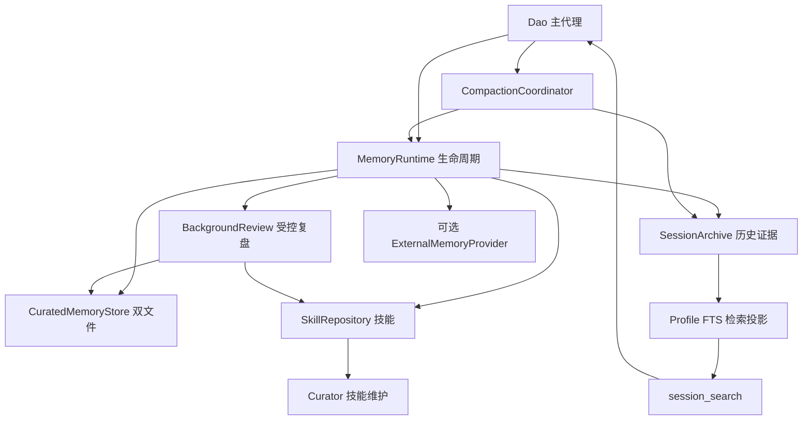

# Dao 全量采用 Hermes 记忆方案技术设计

状态：已按本设计实现核心闭环及迁移操作面；实际使用、明确适配差异和验证边界见 [实现说明](../../architecture/hermes-memory.md)。日期：2026 年 10 月 27 日。

以下保留设计基线与完整验收目标；不将未执行的真实模型效果评测写成已通过，也不表示已迁移用户真实数据。

目标是以 Hermes 的完整记忆闭环替代 Dao 当前记忆系统：双文件长期事实、可检索的会话原文、技能经验、后台复盘、压缩交接，以及可选外部记忆提供器。旧 Dao 的记忆提取、分层注入、相似度合并、评分遗忘和默认 Mem0 后端退出生产运行，不与新系统长期并行。

采用 **TypeScript 原生移植，按固定上游版本做行为对齐**。保留 Dao 的主代理、模型客户端、权限系统、任务调度和 Node/Bun 发布方式。不是直接运行整个 Hermes，也不是把现有 Mem0 适配器改个名字。

本设计取代 [2026-10-26 个人代理记忆方案](./2026-10-26-personal-agent-memory-trd.md) 中默认 Mem0／本地 BGE 记忆服务的路线；该文档暂保留为历史方案。本次仅新增设计，不启动服务、不迁移真实数据、不修改现有业务代码。

## 1 采用基线和完整交付的定义

上游固定为 `NousResearch/hermes-agent@1ae3c55e4bb16f495ebf0536a5672782d903e15e`，本地源码位于 [hermes-agent](/Users/huaruoxu1/DaoProject/hermes-agent)。细节依据 [源码分析](../../architecture/hermes-memory-analysis.md)。实施期间不直接追随 main，后续升级需要差异清单和回归。

“完整采用”的验收对象是 Hermes 默认记忆闭环及外部扩展契约：

| 能力 | 必须交付的行为 |
| --- | --- |
| 本地长期事实 | `MEMORY.md`／`USER.md`、字符预算、批次 add/patch/remove、完整性保护 |
| 固定上下文 | 会话启动冻结，写入不改变旧前缀，正常压缩边界刷新 |
| 历史回忆 | 原始消息持久化、FTS、消息锚点、首尾与周边窗口、压缩归档回查 |
| 程序性经验 | 技能发现／读取／管理、任务经验写入技能、支持文件完整保留 |
| 后台学习 | 回复交付后受控 fork、用户回合／代理迭代双计数、成本和取消边界 |
| 技能维护 | 使用统计、stale／archive、保护与恢复、可选模型合并 |
| 外部扩展 | 单外部 provider、召回注入、完成回合同步、生命周期和身份隔离 |
| 操作面 | 查看、待审批、批准／拒绝、技能维护、状态与审计 |
| 迁移 | 旧文件及 Mem0 导出、可审查映射、保留未激活数据、会话兼容与回滚 |

只完成两个 Markdown 文件，或继续沿用 Dao 旧反思器写入新文件，都不算完成替换。

外部 provider 默认关闭，这与 Hermes 默认行为一致。Honcho、Mem0 等独立插件的服务端算法不由 Dao 重写；Python 插件也不会因 TypeScript 接口相似就自动兼容。选定插件需要单独的原生适配或显式桥接。首个完整默认版不依赖任何外部插件；发布说明必须区分“核心行为对齐”与“兼容全部 Hermes 插件”。

## 2 技术路线选择

| 路线 | 能复用什么 | 代价 | 决策 |
| --- | --- | --- | --- |
| 直接 import Hermes Python 文件 | 部分 MemoryStore／查询代码 | 依赖 Python 和其配置／全局状态，仍需重接主循环、fork、技能与压缩 | 不选 |
| 常驻 Python Hermes 服务 | 可较多复用 Python 存储和插件 | 需要双运行时、IPC、安装维护；主模型工具、缓存和权限仍分布在两边 | 不作为默认 |
| TypeScript 行为移植 | 完整采用分层和生命周期，复用 Dao 运行基础 | 需要维护上游契约和差分测试 | 推荐 |
| 改用 Hermes 整个代理 | 上游功能覆盖最多 | 实质替换 Dao 产品，不是仅替换记忆 | 超出本次范围 |

Hermes 记忆不是独立 SDK，关键调用链分布在 `agent_init`、`system_prompt`、`turn_context`、`turn_finalizer`、`background_review`、`session_search`、技能工具和压缩代码中。因此原生移植要按行为模块进行，而不是逐文件机械翻译。

移植保留上游 MIT 版权和许可文本，将采用的提交、文件、行为测试及本地差异记录在拟新增 `third_party/hermes-memory/UPSTREAM.md`。这里仅放来源与契约资料，不把整个平级仓库打包为 Dao 运行依赖。

## 3 删除哪些旧语义和保留哪些基础设施

### 退出生产路径

- `MemoryWrite`、`MemoryRead` 旧工具，不再暴露给新会话。
- `MemoryBackend` 的 files／mem0 二选一运行模式；旧 Node Mem0 实现只留到迁移工具完成提取。
- 项目／用户／knowledge 三层记忆加载、type 路由、importance 排序、标题长尾注入。
- 旧 `distill`、`consolidate`、GC 衰减、sourceHash 校验、confirmed／provisional 或 uses 晋升相关运行逻辑。按实际引用图清理，不能仅删文件而遗漏调用。
- `unified_reflect` 中的 memories／mergeInto／corrections／confirmed 提取写入链。
- `--reflect-memory` 和 `DAO_DISTILL_*` 等旧策略开关，不再控制一套并行提取器。

旧记录中的 source、confidence、origin、locked 等字段完整保存在迁移档案，不自动抹掉。新双文件运行时不继续按这些字段排名或验证，否则会变成混合方案。

### 保留并接入

- Dao 主执行循环、模型路由、流式交付、任务恢复与工具执行账本。
- 权限规则、只读计划模式、秘密检测、用户当前指令优先级。
- 独立的 challenger／refocuser 等进展检查；禁止它们偷偷写记忆。旧统一反思中的进展部分如继续有用，拆为只读 advisory，避免行为悄然消失。
- 既有技能发现、外部安装、工具名适配和项目技能可见性；补齐受控写入、来源、版本、归档与治理。
- 已有 SQLite Node/Bun 驱动、会话所有权与后台任务恢复机制。

关键现状：[初始化与反思接线](/Users/huaruoxu1/DaoProject/dao-code/src/index.ts:673)、[旧反思持久化](/Users/huaruoxu1/DaoProject/dao-code/src/agent/reflect_persist.ts)、[持久恢复库](/Users/huaruoxu1/DaoProject/dao-code/src/session/durable_store.ts)、[现有压缩](/Users/huaruoxu1/DaoProject/dao-code/src/agent/compact.ts)。

## 4 模块架构与数据权威



拟新增模块如下；文件名是目标结构，尚未存在。

```text
src/memory/
  runtime.ts                 生命周期入口，替代旧后端统一边界
  config.ts                  新配置及旧配置升级
  profile.ts                 显式、不可变的身份与目录解析
  curated_store.ts           双文件、预算、操作、锁内重读
  curated_codec.ts           § 分隔、Unicode 字符计数、渲染
  prompt_snapshot.ts         冻结快照和压缩刷新
  pending.ts                 待审批提议及旧条目钉住
  provider.ts                外部提供器协议
  provider_manager.ts        生命周期、排队、超时、脱敏
  recall_context.ts          原文与模型输入副本分离
  migration/                 旧数据读取、计划、提交、核验
src/session/
  archive.ts                 原始消息和压缩归档
  history_index.ts            profile 级可重建 FTS
  message_envelope.ts        稳定消息 ID 与来源
src/learning/
  background_review.ts       触发与 fork 生命周期
  review_executor.ts         执行白名单、预算、取消栅栏
  prompts.ts                 上游路由提示的 Dao 适配
src/skills/
  manage.ts                  受控编辑和支持文件管理
  provenance.ts              来源和管理资格
  ledger.ts                  变更记录和回滚
  curator.ts                 维护时钟、归档、可选合并
```

### 存储布局

```text
~/.dao/
  settings.json
  memories/MEMORY.md
  memories/USER.md
  memory-control.db           协作锁、提议、运维记录；不是第二份事实库
  history.db                  已注册会话的全文检索投影
  skills/                     兼容已有用户技能目录
    .archive/
    .curator_backups/
    .curator_ledger.jsonl
  migrations/hermes-memory/<migration-id>/
    manifest.json
    export/                   旧记录与完整元数据
    plan.json
    checksums.json
  profiles/<profile>/         非默认 profile 的同构学习状态

<workspace>/.dao/sessions/<id>/session.db
                             原有恢复库，增加消息原文和索引 outbox
```

明确三种权威：记忆正文以双文件为准；技能以磁盘包为准；历史原文以每个会话的持久库为准。`history.db` 仅是查询投影，损坏可重建，不能参与工具是否已执行的判断。

保留 Dao 每会话数据库，是与 Hermes 单 profile `state.db` 的基础设施差异。它避免为了记忆检索重写已存在的任务恢复和所有权协议；检索、归档与回忆的用户语义仍按 Hermes 对齐。

## 5 Profile 和项目边界

默认 profile 使用 `~/.dao`，同一 profile 在不同项目共享两个事实文件和历史检索域，与 Hermes 一致。需要隔离时使用拟新增 `dao --profile <name>`；本轮只要求学习状态、会话身份正确隔离，不把账号配置的全面 profile 化混进来。

`MemoryScope` 在会话初始化时固定，包含 `profileId/home/workspaceId/sessionId/actorKind`；工具、后台复盘、定时维护和子任务显式继承该对象。禁止靠进程级环境变量临时切换多个活跃会话的身份。

- CWD 或工作树变化不会自动创建第二套项目记忆。具体项目规则优先进入项目技能／现有项目上下文，而不是所有会话常驻文件。
- 历史索引只收录已绑定该 profile 的会话。默认允许在同 profile 查跨项目历史；查询提供可选 workspace 过滤。工具的路径越权规则不因历史索引放宽。
- 同名项目以 canonical path 派生的 workspace ID 区分；会话使用独立 archive UUID，不能只靠当前时间字符串避免全局碰撞。
- 旧会话首次迁移登记明确绑定一个 profile；恢复时若 profile 不符，拒绝隐式换归属。
- 普通子代理可读取父快照；本地显式写入权限按父授权与工具集确定。复盘 fork 有独立严格白名单。外部 provider 不为普通子代理重复同步整份父历史，父侧只观察委派结果。

项目级记忆隐式隔离将变成显式 profile 或任务技能适用范围，这是替换的可见行为变化，必须在切换说明中列出。

## 6 双文件记忆行为契约

### 工具与预算

新会话使用上游工具名和语义：`memory(target, operations)`，操作 `add|patch|remove`，一个调用只针对一个文件。新 prompt 不再列出 `MemoryRead/MemoryWrite`。历史旧调用仅用于显示和结果重放，不在新会话重新执行。

默认 `MEMORY.md=2200`、`USER.md=1375` 字符，条目分隔符 `\n§\n`。计数必须按 Unicode code point，**不能使用 JS `string.length` 直接代替 Python `len`**；emoji、组合字符、中文和分隔符均有固定兼容样例。禁止偷偷做 Unicode 归一化后改变匹配正文。

按上游对齐：精确字符串去重、完整条目匹配优先、歧义拒绝、唯一片段 patch、最终批次预算、失败整批不写、过载返回整理指引、成功不回显全库、每回合整理失败预算。

写满时不按旧 importance 自动淘汰，也不自动迁往 Mem0。用户可以调整预算，但不能把默认预算悄悄扩大成原有全量注入。

### 文件提交

通过同 profile `memory-control.db` 的短 `BEGIN IMMEDIATE` 事务协调所有 Dao 管理的写入；事务内同步完成读文件、校验和同目录临时文件替换。数据库锁只协调写入，不承担正文存储。写文件失败回滚控制事务并返回真实失败。

文件写入采用 flush／原子替换及适用平台的持久性处理，启动测试覆盖 Node 和 Bun。存在文件却读取失败时拒绝写入；保留超长外部编辑的漂移保护。人工编辑不遵守协作锁，无法据此保证与任意外部编辑器之间的跨进程事务；文件变更检测只能减少冲突，不能虚构这种保证。

文件提交与工具结果账本不在同一个事务域：若文件已替换但进程未记录结果就崩溃，延续 Dao `outcome_unknown` 语义，通过实际文件核实，不能自动重复 patch/remove。普通 add 的精确去重也不能替代通用的恰好一次保证。

### 来源与审批

普通 foreground 写入走 Dao 原权限规则及 `memory.write_approval`；`plan` 模式始终只读。`write_approval=false` 不得绕过上层 deny。

无人值守 background review 的 patch/remove 整批暂存，即使普通审批关闭；add 可在允许范围执行。提议保存目标完整旧条目、操作和来源，在批准时锁内重新核对；旧条目已变拒绝应用。审批只批准该内容，不授予之后的持续写权限。

加载和写入都移植威胁扫描；加载命中的原始文本留在磁盘，系统提示只放阻断占位。Dao 保留“记忆低于用户当前指令和实时证据”的权限原则，不复制外部召回 wrapper 中容易被误读的强权威措辞。这一项作为明确本地差异记录。

## 7 会话原文和检索

### 原文必须在压缩前持久化

当前 `PersistedState.messages` 是活跃快照，`events.jsonl` 还是 best-effort 写入，不能直接把它们当成完整历史库。升级每会话 `session.db` schema，新增：

```text
messages(
  message_id, sequence, role, content_json, api_content_json,
  tool_call_id, origin, created_at, active, compacted
)
compactions(
  compaction_id, source_revision, summary_message_id,
  before_ids, retained_ids, status
)
history_outbox(event_id, source_revision, payload, delivered)
```

上述是逻辑字段，最终 DDL 按现有驱动限制落地。source revision 来自会话权威库。摘要、review、系统注入等必须有独立 origin；多模态正文保留可追溯附件引用，文本索引不复制 base64。

已完成消息先提交到权威库，再允许被剪枝；工具调用与结果通过真实 `tool_call_id` 关联，不能从渲染日志猜。流式未结束内容标 partial，不作为完成回复交给外部记忆提取。

全局 `history.db` 在后台消费 outbox，按 `event_id/message_id/revision` 幂等更新 FTS，成功后才确认水位。跨库不假设原子提交；崩溃后重放允许重复交付但不能产生重复消息。查询展示索引滞后／失败状态，必要时对已知会话直接读权威库，不能以“无结果”冒充“尚未索引”。

已有 schema v2 会被旧程序拒绝读取更高版本。升级必须事务迁移并保留离线备份；回滚不能靠把 user_version 改回 2。恢复路径同时升级读取和版本检查。

### session_search

采用上游四种模式：query 发现、session_id 读取、around_message_id 周边窗口、无参数浏览。默认发现 3 个会话，候选上限 300；高排名展开、其余简洁；长会话首 20／尾 10、单条 2000 字符，窗口另有上限。

默认用户／助手文本，支持显式角色和时间过滤；cron 降权、子代理及内部复盘来源排除、lineage 去重、当前活跃上下文排除但 compacted 原文可查。工作区过滤是 Dao 适配参数，不改默认同 profile 回忆。

检索算法为 FTS5／标题／CJK 路由，不加入向量检索替代默认行为。Node 与 Bun 发行物必须验证 FTS5。中文功能不能留到未来：对齐 CJK、trigram、LIKE 的上游回退契约；无法加载原生 CJK 扩展的发行物可使用其允许的回退，但必须通过中文正确性与耗时验收，并明确性能差异。禁止悄悄引入一个排序不相容的分词器又称完全一致。

历史正文需要保留原始用户输入与 API 副本：注入的召回、技能说明不能变成“用户曾经说过”。默认搜索原始正文，API 副本用于稳定重放和审计。

## 8 压缩完整替换

Dao 当前“系统提示＋整段增量摘要、无原文 tail”的策略需要替换，否则不能完整采用 Hermes 的回忆机制。目标为：旧工具结果裁剪 → 选取合法消息边界 → 结构化摘要／锚点 → 保留 token 受限的近期原文 → 原地归档旧消息。

采用基线配置：基础 threshold 0.50，小于 512K 窗口至少 0.75；`tail_mode=lean`、`protect_last_n=20`、`min_tail_user_messages=1`、`in_place=true`。token 预算和消息最小保留的冲突处理按上游算法移植，不能只改这几个默认值。近期工具调用与结果必须成组保留，不能生成孤立 tool 消息。

提交顺序：

1. 取得会话 revision、活跃消息 ID 和只读快照。
2. 可选 provider checkpoint；严格模式失败则保持原状态。
3. 在锁外生成摘要和候选 tail，不提前修改 live messages。
4. 再取得会话提交栅栏，确认 revision、会话身份和取消状态仍相同。
5. 同一会话事务提交归档标记、摘要／tail、checkpoint 与索引 outbox；失败全部不切换。
6. 提交成功后更新内存上下文，刷新双文件及技能系统快照，开始新的缓存 epoch。

摘要失败时使用有界确定性兜底，旧证据仍保存在库中，提示 `session_search` 回查。禁止沿用旧的“细节已舍弃，只能问用户”作为正常降级语义。

普通记忆写入不刷新系统提示；恢复同一会话应使用已持久化的 prompt epoch，而不是重启就隐式重新加载。新会话／正常压缩提交才刷新。复盘快照捕获 epoch，不能在 fork 的第一条请求前混入父会话已更新的工具表或提示。

本次不移植 Hermes 不适用于 Dao 当前模型传输的所有 provider 原生压缩协议；每个 Dao 已支持的传输至少遵守上述本地归档、事务和缓存边界，差异列入兼容表。

## 9 后台复盘和技能经验层

### 触发与 fork

新默认自动学习开启，记忆按 10 个真实用户回合、技能按 10 个代理迭代触发。这个默认与旧 Dao `--reflect-memory` 默认关闭不同，是本方案明确采用 Hermes 行为的变更。计数持久化，系统注记、后台事件及重试不能算新用户回合。

只有回复交付完成、未中断、非一次性／禁止后台学习的执行上下文才能派发。复盘允许“无内容可保存”，不再用旧提取提示中的“宁可多抽”。任务经验写技能，全局事实写双文件，进展日志留历史。

复用 Dao 的模型客户端和循环基础，但新增专用 review executor，**不能直接使用普通 fork 的默认 directive**：现有 directive 包含开发提交等任务语义，不适合记忆维护。

同模型复盘使用父请求的 system、tools、消息与推理配置字节快照，以及适用传输的缓存身份；工具执行端白名单仅开放 memory、技能读取／管理和必要只读文件工具。禁止 terminal、任意文件写入、递归委派、发送消息、部署和计划任务创建；额外工具必须显式配置，并且不能绕过上层权限。

父历史不记录复盘内部请求，复盘不结束父会话；用量计入父会话的 background_review 项。默认最多 16 次迭代，输入总额采用 `min(600000, 0.75 × context_window)`，未知窗口保守回退 120000；附加实际费用上限可配置。命中缓存仍计入成本，不把后台调用视为免费。

新前台输入取消当前复盘，等待确认最多 2 秒。为适配 JS 异步执行，使用 run token／generation 检查：即使远端请求无法取消，迟到响应也不得启动新写入。已经进入原子提交的单次操作允许完成，但不得继续下一操作。退出不无限等待后台模型。

### 技能管理与 Curator

新模型工具采用 `skills_list`、`skill_view`、`skill_manage` 的对应语义；现有 `Skill` 可作为旧会话兼容入口，但新 schema 不同时宣传两套等价工具。`SkillInstall` 保留负责用户授权安装，不让复盘把安装工具当编辑器。

技能编辑覆盖正文及 references/scripts/templates/assets。每次变更记录 actor、来源、前后 hash 和可恢复内容；后台编辑遵守 read-before-write。所有路径经过所属技能目录校验和真实路径解析，不能通过支持文件路径越界写项目源码。

记录 agent-created、用户创建、hub／external、bundled 来源，不根据目录猜来源。保留已安装技能原包；迁移来源不明的技能默认不交给 Curator 自动删除。

Curator 对齐：168 小时间隔、至少空闲 2 小时、首次建立基线；14 天 stale、30 天 archive；默认只管理合格的 agent-created 技能，cron 引用和 pinned 跳过自动迁移。模型合并默认关闭，开启后保留整包引用关系、备份和回滚；永久清理只能显式执行。pin 的普通编辑／删除语义按固定源码对齐，不把文档中的旧“全部只读”说法移植进来。

技能目录变更通过追加式消息注记进入当前会话；不重写已有系统索引。压缩后以当前有效目录重建。技能使用统计迁移后只用于技能发现与治理，不重新变成 Dao 旧记忆评分器。

## 10 外部 Provider 接口及可选 Mem0 路径

拟定的逻辑接口如下，具体签名实施时绑定真实消息类型：

```ts
interface ExternalMemoryProvider {
  name: string;
  initialize(scope: MemoryScope): Promise<void>;
  systemPromptBlock(): string;
  onTurnStart(turn: TurnIdentity): Promise<void>;
  prefetch(query: string, sessionId: string): Promise<RecallResult>;
  syncTurn(turn: CompletedTurn): Promise<void>;
  queuePrefetch(query: string, sessionId: string): Promise<void>;
  onMemoryWrite(write: CommittedMemoryWrite): Promise<void>;
  onPreCompress(input: CompressionEvidence): Promise<CheckpointResult>;
  onSessionEnd(session: SessionEvidence): Promise<void>;
  onSessionSwitch(change: SessionBoundary): Promise<void>;
  onDelegation(result: DelegationEvidence): Promise<void>;
  toolSchemas(): ApiTool[];
  shutdown(): Promise<void>;
}
```

同 profile 最多一个外部 provider；本地两个文件始终独立。静态说明进入 system，动态召回只进入当前用户消息的 `api_content`。每回合 prefetch 一次，默认最多等待 8 秒；卡住的 provider 有并发上限和恢复探测，不能为每次查询无限增加 worker。完成回合按序同步，退出最多等待 5 秒并报告未排空数量。恢复／重试是否去重取决于适配器，不能承诺远端恰好一次。

用户输入和所有出站正文先走统一秘密脱敏；工具只收到当前 scope 的调用环境。sync 不发送被中断的完成回合；不把模型 reasoning 私有字段默认当作学习证据。外部失败不自动切换到另一家远端服务，也不把本地已成功提交的记忆回滚。

旧 `DAO_MEMORY_BACKEND=mem0` 不自动变成 `memory.provider=mem0`：前者保存 Dao 已提炼记录，后者可能接收整轮会话，数据范围和提取责任不同。首次完整版将旧 Mem0 作为迁移源，默认 provider 为空。后续如选择 Mem0，按上游 catalog 固定版本核实原生适配，并分别验收提取、镜像更新／删除、身份与网络数据流；不得直接复用旧 `infer:false` 存储适配器宣称已实现 Hermes provider。

这部分是可选生态接入边界；默认闭环的最终验收仍必须用契约 provider 验证全部 hook、失败与隔离路径，不能只定义一个从未调用的接口。

## 11 配置与操作面

拟放入 profile 的 `settings.json`，不再增加一组行为型环境变量：

```json
{
  "memory": {
    "memory_enabled": true,
    "user_profile_enabled": true,
    "memory_char_limit": 2200,
    "user_char_limit": 1375,
    "nudge_interval": 10,
    "write_approval": false,
    "provider": ""
  },
  "skills": { "creation_nudge_interval": 10, "write_approval": false },
  "background_review": { "enabled": true, "model": "inherit", "max_iterations": 16 },
  "curator": {
    "enabled": true, "interval_hours": 168, "min_idle_hours": 2,
    "stale_after_days": 14, "archive_after_days": 30,
    "consolidate": false, "prune_builtins": false
  },
  "compression": {
    "threshold": 0.5, "tail_mode": "lean", "protect_last_n": 20,
    "min_tail_user_messages": 1, "in_place": true, "checkpoint_required": false
  }
}
```

这是新配置结构，不表示现有 Dao 已支持。旧配置迁移明确报告弃用项，不静默让用户以为旧开关仍生效。

命令至少包括：

- `/memory` 查看两库原文、用量和当前快照 epoch；`pending/approve/reject` 处理提议。
- `dao memory status` 显示 profile、默认机制、provider 和后台状态。
- `dao memory migrate plan|apply|verify`；`dao memory legacy search|show` 只读检索未进入新活跃系统的迁移档案。
- `/refine` 显式发起一次学习复盘，与自动复盘标记区分；不是代码审查命令。
- `dao curator status|run|restore|pin|unpin|ledger|rollback`，支持 dry-run。
- `/audit memory` 报告真实写入／提议／失败／召回／后台成本，不统计“模型说记住了”。

保留 `--no-memory` 作为 Dao 隐私总开关：禁用记忆文件读取、memory 工具、外部 provider、历史检索和自动学习；基础任务恢复存储仍照常运行，不能因此破坏崩溃恢复。另设精细配置只关闭某一层。`--eval` 使用隔离临时 profile 且不学习，防评测污染。

总开关比 Hermes 的部分单项开关更宽，是保留 Dao 已有用户预期的显式差异，不允许藏在实现里。

## 12 旧数据迁移与切换

### 迁移原则

旧 Dao 全量记录不可能无损塞进默认 3575 字符。**保留所有原数据与让所有旧事实继续自动召回，是两件事。** 不用扩大预算、塞一篇超长技能或保留旧后端暗中检索来伪装兼容。

迁移分为无损导出和选择性激活。任何旧条目都必须有归宿：新双文件、适用范围明确的技能、既有上下文中的重复记录、只读历史档案或待决。保留原文、元数据、源路径／ID、hash、时间和映射理由；待决／归档不计作已激活记忆。

| 旧内容 | 默认迁移方向 |
| --- | --- |
| 明确表达且跨任务稳定的用户事实 | USER.md 候选，预算内激活 |
| 通用稳定环境／约定 | MEMORY.md 候选 |
| 某类任务的做法、反馈与坑 | 项目或用户技能；必须有适用条件和可复用流程 |
| 项目进展、一次性决策记录 | 保留原会话证据；缺原会话则保留明确标注的迁移档案 |
| 推断、冲突、来源不足、locked 的受保护事实 | 待决或带完整说明保留；不自动升级成确定事实、不绕过保护 |
| 已 superseded 或已删除的内容 | 只保留相应历史状态，不重新激活 |

迁移归类可由模型提出，但 `plan` 不改源数据，计划必须列出最终两个文件全文、技能 diff、所有未激活条目与实际字符数。不能按旧类型机械判断所有 feedback 都是全局偏好。用户接受具体计划后才执行实际迁移。

### 执行步骤

1. 枚举用户层、已登记项目层、knowledge 和已配置 Mem0 记录；只读导出并生成计数／hash 清单。不扫描磁盘上所有项目。
2. 建立计划。为每条源记录生成稳定迁移键；重复 plan/apply 不重复生成技能或事实。
3. 关闭旧写入者或等待其退出；用源 hash／revision 验证计划仍基于当前数据。存在活跃旧进程时不并行迁移。
4. 在临时目标目录生成全部新文件、技能、提议和配置；检查预算、路径、保护、引用和数据覆盖。
5. 以激活清单和原子配置切换提交；跨多个文件的步骤通过迁移 journal 恢复，不能声称多个 rename 天然构成一个事务。
6. 新会话启用 Hermes 模式，旧会话只能只读查看或显式创建新的继承会话。不能拿旧 system prompt 继续运行却替换工具协议。
7. verify 对账：源总数等于全部映射状态总数；任何遗漏、冲突未处理、hash 漂移都显示失败。

已有旧会话用 state／events／session.db 的实际可用数据重建历史索引；缺消息 ID 的记录分配稳定的导入 ID，无法确认的工具关联标为 unknown。压缩前原文已经丢失的不能恢复，不能把摘要伪造成原文。

### 回滚

保留旧二进制、配置和数据快照。回滚停止新写入者，先导出新系统期间新增内容，再切回独立旧快照；新 profile／档案不删除，不自动反向猜测成旧记忆类型。

升级后的活跃会话不能交给旧版直接恢复执行。只读导出允许，后台未决操作必须沿用现有恢复裁决。明确告知旧版只拥有切换前快照，不声称新记忆自动双向同步。

## 13 分阶段实施与完整验收

阶段用于控制工程风险，**全部完成后才切默认并宣布完整替换**。不发布一个仅含双文件、仍依赖旧反思器的半套默认方案。

| 阶段 | 产物 | 放行条件 |
| --- | --- | --- |
| A 基线与隔离 | 上游锁定、行为样例、差异清单、新模块边界、独立测试 profile | 新代码不触碰真实旧记忆，无隐藏旧写入者 |
| B 双文件与操作面 | store、memory 工具、快照、提议与查看 | 行为差分、文件失败和并发测试通过 |
| C 会话证据与压缩 | 稳定消息 ID、归档、outbox／FTS、session_search、新压缩 | 崩溃重放、压缩回查、中文与多会话隔离通过 |
| D 学习与技能治理 | review executor、技能管理／账本、Curator | 缓存、权限、取消、成本和包完整性通过 |
| E 外部契约与迁移 | manager 全生命周期、契约 provider、迁移和回滚工具 | 时序、失败注入、旧数据覆盖与中断恢复通过 |
| F 总切换与清理 | 新默认、旧链路退出、文档／测试／打包更新 | Node 和 Bun 的集成回归与真实记忆场景验收完成 |

### 必测契约

1. **对上游行为差分**：相同初始文件与操作序列在固定 Hermes Python 和 Dao TypeScript 上执行，比较磁盘正文、匹配结果、预算、终止信号和提议状态；临时路径／措辞等非语义差异归一化。emoji 长度、BOM、重复子串、重试上限、整批失败必须覆盖。
2. **写入故障**：读取失败、磁盘满、原子替换失败、提交后进程退出、两个进程写同库；无静默清空，无自动重复破坏性操作。
3. **缓存与历史**：普通写入前后 system/tools 字节相同；压缩成功才换 epoch；恢复复用已持久化字节；review 不污染父历史；新回合注入不改旧消息。
4. **检索**：中文短词、同义改写漏召回边界、时间筛选、cron 降权、profile 隔离、同 session 的 compacted 原文、live 排除、索引滞后恢复。
5. **压缩事务**：摘要失败、用户中断、revision 变化、provider checkpoint 失败时不提交半成品；工具配对合法；证据可回查。
6. **后台执行**：10 用户回合和 10 迭代分别计数；一次性模式不复盘；新输入取消后迟到模型不写；后台删改暂存；不递归派发；成本归账准确。
7. **技能维护**：外部／用户技能来源保护、未知来源默认不清理、pinned／cron 引用保护、归档恢复、支持文件和相对链接保留、首次不立即维护。
8. **迁移与回滚**：重复执行幂等、中断继续、源变化拒绝、超预算可见、旧 deleted 不复活、回滚不破坏新数据和活跃任务恢复。
9. **产品回归**：所有入口的启动／继续／切会话／退出，`--no-memory`、`--eval`、权限模式、npm 和 Bun 单文件发行。

### 效果与成本验收

建立固定跨会话任务集，对照旧 Dao、新方案、无记忆三种配置，使用相同模型和任务：明确偏好记住、一次选择不泛化、旧偏好被纠正、项目规则不串用、历史原因回溯、技能复用、错误经验不固化、超预算不丢原档。

记录任务通过率、错误记忆导致的偏离、显式写入兑现率、相关历史召回、每轮延迟、主／后台 token 与费用。确定性契约必须全过；效果指标由基线报告给出，不预先宣称 Hermes 一定优于旧 Dao。若真实任务显著退化，保持新默认切换关闭并定位具体链路，不能靠双跑旧系统掩盖缺陷。

## 14 工作量判断与最终交付

这属于中大型子系统替换，主要工作不在双文件 CRUD，而在消息证据、压缩事务、受控复盘、技能维护和旧数据兼容。合理的最小里程碑是先完成 A 与 B 的契约验证，再据实际差分和会话 schema 改造估算其余阶段；未实施前不给未经验证的精确人天承诺。

最终交付应包含：新运行模块、旧链路清理、上游行为对照、全部确定性测试、真实任务评测报告、迁移计划／执行／回滚工具、Node/Bun 打包验证、用户切换说明。最终状态只有一套活跃记忆策略；旧数据读取器属于迁移和历史维护工具，不再参与主代理的学习判断。

需要接受的产品变化也很明确：默认不再依赖 embedding 或 Mem0；常驻事实预算缩小；项目知识改由技能和历史回忆承载；自动复盘默认开启；后台删改有提议流程；旧结构化置信度／遗忘评分不再是运行时机制。换取的是与 Hermes 一致、边界清晰且可测试的完整记忆闭环。
